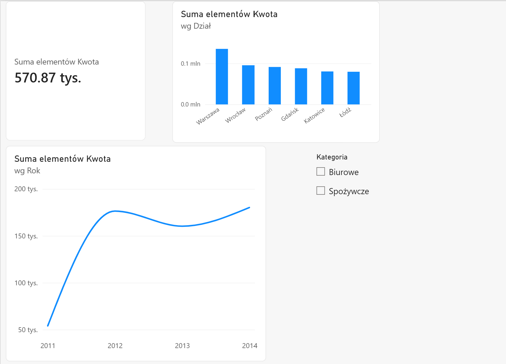
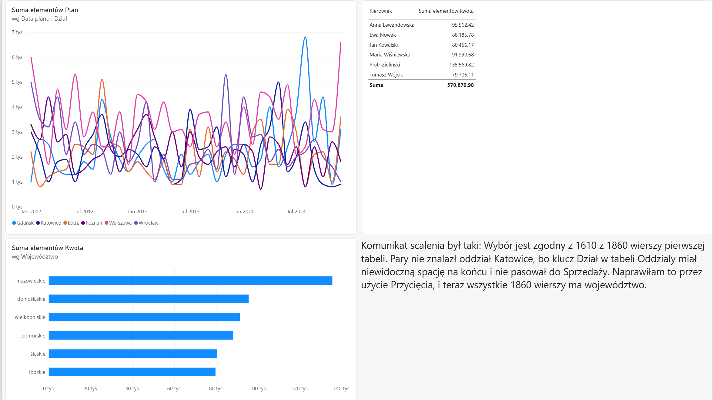
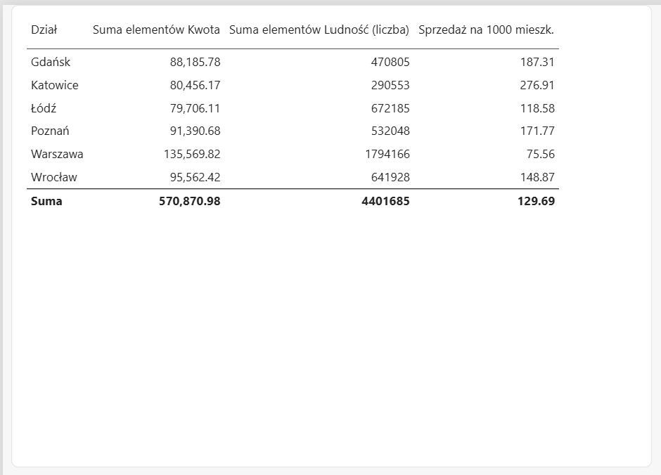
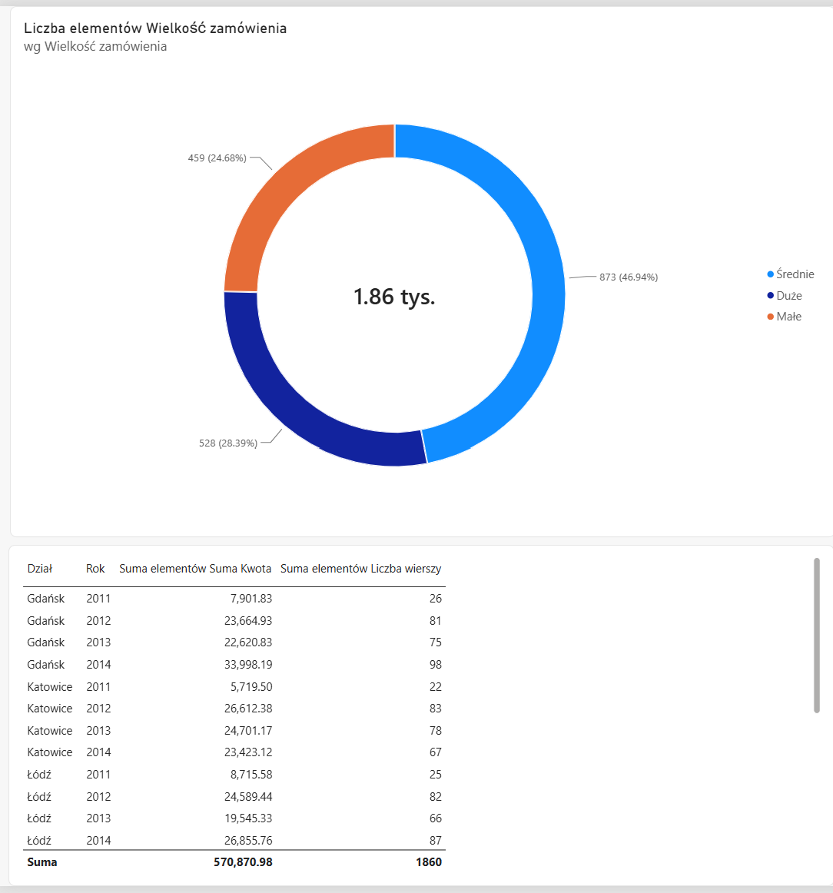

# Wholesale Sales Report – ETL in Power Query

Power BI report for a wholesale network with branches in six Polish cities. The focus of this project is **data preparation in Power Query**: combining files from multiple branches, reshaping a CSV sales plan, enriching data with web sources and fixing data quality issues, so that the report **updates automatically** when new data arrives.



## Business questions

- What are total sales by branch, category and over time?
- How does the sales plan look across branches and months?
- Which regions (voivodeships) and branch managers generate the highest sales?
- Is the branch with the highest sales also the leader per 1,000 residents?
- What is the structure of orders by size?

## Data sources

| Source | Format | Content |
|---|---|---|
| Branch sales files | 6 × Excel (folder) | Transactions: date, branch, customer, category, product, quantity, price, amount |
| Sales plan | CSV (UTF-8, semicolon) | Monthly plan per branch and year, months in 12 columns |
| Branches | Excel | Voivodeship, branch manager, opening date, headcount |
| City population | Web (Wikipedia) | Population of Polish cities |
| Corrections | Manual entry | Product returns with negative amounts |

## Power Query – key steps

**1. Automated folder import**
- Imported all branch files from one folder; unpacked workbooks with `Excel.Workbook([Content])` and promoted headers with `Table.PromoteHeaders([Data])`
- Set data types and loaded a single *Sales* table
- **Tested automation:** after adding a new branch file and clicking *Refresh*, the report grew from 1,600 to **1,860 rows** (491,164.87 → **570,870.98**) without changing any steps

**2. Reshaping the sales plan (unpivot)**
- Unpivoted 12 month columns into a long format (Branch, Year, Month, Plan) → **216 rows**, total plan **529,000**
- Built a proper date column:

```M
List.PositionOf({"Styczeń","Luty","Marzec","Kwiecień","Maj","Czerwiec","Lipiec","Sierpień","Wrzesień","Październik","Listopad","Grudzień"}, [Miesiąc]) + 1
#date([Rok], [Nr miesiąca], 1)
```

**3. Merge and data quality fix**
- Merged sales with the branch table (left outer join): only **1,610 of 1,860** rows matched
- Root cause: the key value *"Katowice"* in the branch table contained an **invisible trailing space**
- Fixed at the source with *Trim* → all **1,860 rows** matched

**4. Web data enrichment**
- Imported city population from Wikipedia, cleaned footnotes and spaces from numbers:

```M
Number.From(Text.Select(Text.BeforeDelimiter(Text.From([Ludność]), "["), {"0".."9"}))
```

- Merged with branches (**6 of 6** matched)

**5. Additional transformations**
- **Append:** sales + corrections (returns) → *Net Sales* table (**1,863 rows**)
- **Conditional column:** order size (Large ≥ 15 units, Medium ≥ 6, otherwise Small)
- **Group By** on a referenced query: sales and number of transactions per branch and year
- **Data profiling** on the full dataset: 7 distinct products, price range 7.20–53.99

## Data model and DAX

- Branches 1 : * Sales
- Branches 1 : * Plan

```DAX
Sales per 1000 Residents =
DIVIDE(SUM(Sales[Amount]), SUM(Branches[Population])) * 1000
```







## Key insights

- **Warsaw** has the highest total sales (**135.6K**) but the **lowest** sales per 1,000 residents (**75.56**), because it is by far the largest city.
- **Katowice** leads per capita (**276.91** per 1,000 residents) despite one of the lowest totals.
- Medium orders dominate: **46.9%** of transactions, followed by large (28.4%) and small (24.7%).
- A single invisible character in a key column caused **13% of rows** to lose their region. Profiling and checking merge results is essential.

## Tools

Power BI Desktop · Power Query (M) · DAX · data modelling · data cleaning

## Context

Built as part of a data analytics course (Power BI). Sales, plan and branch data were provided in the course materials; city population data comes from Wikipedia (CC BY-SA). The report interface and data are in Polish.
